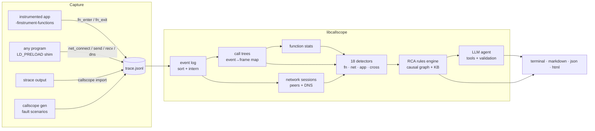

<div align="center">

# callscope

**Call log analysis for any application, at the function-call level and the network-call level, with automatic AI-assisted root cause analysis.**

C11 library + CLI · zero runtime dependencies · works on unmodified binaries · rules engine offline, LLM agent optional

</div>

---

When a program misbehaves you usually have two disconnected views: a profiler that shows *which functions* were slow, and network tools that show *which connections* failed. The real answer lives where they meet:

> `charge_payment` is slow **because** 97% of its time is a `recv()` from `10.0.4.22:9102`.
> The `SIGSEGV` in `parse_payment_response` happened 4 ms **after** an `ECONNRESET` from the same peer, on the same thread.

callscope records both levels into one trace, rebuilds call stacks, stitches network sessions, links every network call to the function that made it, runs 18 detectors, and then works out the **root cause**: a deterministic causal-graph engine always, plus an LLM agent that investigates the evidence with tools when you give it an API key.

```text
$ callscope record --report report.html -- ./orderservice --requests 8
orderservice: 0/8 orders completed
callscope: 372 events, 6 findings. Root cause: The service at 127.0.0.1:19102 was not
accepting connections (ECONNREFUSED): it was down, restarting, or listening on a different port.
```

## What it does

| Level | How it is captured | What you learn |
|---|---|---|
| **Function calls** | Build with `-finstrument-functions`, link `libcallscope_trace` | Call trees per thread, inclusive/exclusive time, p50/p95/p99, crash site, runaway recursion, hangs, hotspots |
| **Network calls** | `LD_PRELOAD=libcallscope_net.so` on **any** dynamic binary (Python, curl, Java, ...), or import `strace` output for anything else | connect/accept/send/recv/close/DNS with latency, errno, bytes; sessions per fd; per-peer error rates |
| **Application** | `cs_error("CODE", ...)` / `cs_log(...)` from your code | Errors in the same timeline as the calls that caused them |
| **Cross-level** | Every event is mapped to the frame that was open on its thread | "slow because of the network", "network failure propagated into app errors / crash" |

Then:

- **Detectors** turn evidence into findings (`net.connect_failure`, `net.retry_storm`, `fn.recursion`, `cross.error_propagation`, ... see [docs/detectors.md](docs/detectors.md)).
- **Root cause analysis** ranks findings by how much they *explain*, builds the causal chain and attaches fixes and next checks from a failure-mode knowledge base ([docs/ai-rca.md](docs/ai-rca.md)).
- **AI auto-investigation** (optional): an LLM agent gets an evidence pack and read-only tools (`get_finding`, `search_events`, `get_call_stack`, `get_peer_stats`, ...), investigates, and answers with a verdict that is **validated against the evidence**. Hallucinated findings are rejected; on any failure you get the rules result.
- **Reports**: coloured terminal summary, Markdown for tickets, JSON for pipelines and a single-file HTML report with verdict, causal chain, timeline and flame graph.

## Architecture



Everything below the trace file is a plain C library (`include/callscope/*.h`), so the same analysis can be embedded in other tools.

## Quick start

```bash
# Linux (or WSL on Windows). Needs a C compiler and CMake; libcurl is optional.
git clone https://github.com/mardromus/callscope && cd callscope
make build test

# 1) No setup at all: a synthetic trace with a known fault
./build/callscope gen --list
./build/callscope gen upstream-down -o down.jsonl
./build/callscope analyze down.jsonl
./build/callscope report down.jsonl -o down.html      # open in a browser

# 2) Network level on ANY program, no rebuild
./build/callscope record -o curl.jsonl -- curl -s http://127.0.0.1:9/
./build/callscope rca curl.jsonl

# 3) Both levels: the bundled instrumented C service against misbehaving mocks
./scripts/demo.sh            # writes demo-out/*.html for five failure modes
```

### Tracing your own C/C++ program

```bash
cc -finstrument-functions -rdynamic -O1 -fno-inline -Ipath/to/callscope/include \
   myapp.c -Lpath/to/callscope/build -lcallscope_trace -o myapp
callscope record -o myapp.jsonl --report myapp.html -- ./myapp
```

`-rdynamic` exports function names (static functions appear as `myapp+0x1a2b`, resolvable with `addr2line`). Optionally add context:

```c
#include <callscope/runtime.h>
cs_error("PAYMENT_DECLINED", "order %d declined by gateway", id);
cs_log("warn", "retrying in %d ms", backoff);
```

### Programs you cannot preload (static binaries, other OSes)

```bash
strace -f -tt -T -e trace=network,read,write,close -o app.strace ./app
callscope import strace app.strace -o app.jsonl --date 2026-11-04
callscope analyze app.jsonl
```

Anything that can write the [JSONL format](docs/log-format.md) works too: logs from another language, a service mesh, or your own exporter.

## AI root cause analysis

Works with any OpenAI-compatible API. Nothing is sent anywhere unless you ask for `--ai`.

```bash
export GROQ_API_KEY=...                 # or OPENAI_API_KEY / CALLSCOPE_LLM_API_KEY
callscope rca trace.jsonl --ai -v        # -v shows each tool call the agent makes

# local models through Ollama: nothing leaves the machine
export CALLSCOPE_LLM_BASE_URL=http://localhost:11434/v1 CALLSCOPE_LLM_MODEL=llama3.1
callscope report trace.jsonl --ai -o report.html
```

```text
callscope: asking llama-3.3-70b-versatile at https://api.groq.com/openai/v1
  [agent] get_peer_stats({"peer":"10.0.4.22:9102"}) -> 1873 bytes
  [agent] search_events({"kind":"app_error","limit":5}) -> 2240 bytes
```

The agent's verdict must name a finding that exists. Chain entries that do not exist are dropped, and if the answer is unusable the model gets one chance to correct itself before callscope falls back to the rules result. The report always says which engine produced the verdict.

## Commands

| Command | Purpose |
|---|---|
| `callscope record [-o f] [--no-io] [--report r.html] -- prog args` | run any program with the network tracer preloaded (function events too if it links the tracer) |
| `callscope import strace <file> [-o f] [--date D] [--pid N]` | convert strace output |
| `callscope gen <scenario> [-o f] [--requests N] [--seed N]` | synthetic traces with a known fault |
| `callscope analyze <trace> [--json]` | findings, top functions, peers (exit 1 if problems found) |
| `callscope rca <trace> [--ai] [--json]` | root cause, causal chain, fixes, next checks |
| `callscope report <trace> [-o r.html] [--md r.md] [--json-out r.json] [--ai]` | reports |

Thresholds: `--slow-ms N` (slow call), `--net-slow-ms N` (slow connect / I/O).

## The fault scenarios

`callscope gen` simulates a two-worker order service and injects one fault. The test suite checks that every fault is detected **and** that the RCA blames the right thing:

| Scenario | Injected fault | RCA root |
|---|---|---|
| `upstream-down` | payment service refuses connections | `net.connect_failure` (ECONNREFUSED) |
| `slow-upstream` | payment answers in 1-2.5 s | `net.slow_io` → explains `cross.slow_because_network` |
| `dns-failure` | `payments.internal` stops resolving | `net.dns_failure` (configuration) |
| `recursion-crash` | receipt renderer recurses forever | `fn.recursion` → explains the SIGSEGV |
| `reset-crash` | ECONNRESET, then NULL dereference | `cross.error_propagation` (broken error path) |
| `fd-leak` | error path never closes sockets → EMFILE | `net.conn_leak` |
| `cpu-hotspot` | expensive discount calculation | `fn.hotspot` |

## Project layout

```text
include/callscope/   public headers (event model, json, analysis, rca, report, runtime)
src/common/          code shared by library and runtime (event encoder, clocks)
src/runtime/trace/   -finstrument-functions hooks, symbol cache, crash handlers
src/runtime/net/     LD_PRELOAD shim for the socket API and getaddrinfo
src/core/            log loader, strace importer, analysis, detectors, rca, ai, reports, generator
src/cli/             the callscope command
examples/            instrumented order service, mock upstream, sample traces
tests/               unit, scenario, fake-LLM and CLI end-to-end tests
docs/                architecture, log format, detectors, AI RCA
```

## Design notes

- **One wall clock for everything.** Every component stamps events with `CLOCK_REALTIME` nanoseconds, so traces from the tracer, the shim, child processes and imports merge into one timeline.
- **Allocation-free hot path.** The runtime encodes events into a stack buffer and writes each line with a single `write(2)` on an `O_APPEND` fd: no locks, no interleaving, safe across fork.
- **The event → frame map** built while reconstructing call trees is the bridge between the two levels: it makes "which function made this network call" a lookup.
- **Rules first, AI second.** The deterministic engine is fast, offline and testable. The LLM adds investigation and judgement, but its output is checked against the evidence before it is shown.

## Limitations

- Linux only for live capture (`LD_PRELOAD`, `/proc`). Use WSL on Windows; analysis of existing traces is portable C.
- Function tracing needs a rebuild with `-finstrument-functions`; the network shim and strace import do not.
- TLS traffic is seen as bytes and latency, not plaintext (which is usually what you want for RCA).

## License

MIT © Kushagra Goyal
